# الشاشات المحاسبية الأساسية

هذه الشاشات هي قلب النظام. الفواتير والسندات تُنشئ قيودها هنا تلقائيًا، فتخضع لنفس القواعد: الفترات والقفل والمراجعة والإقفال.

**دورة العمل باختصار:**

1. تأسيس الشركة ودليل الحسابات.
2. فتح السنة المالية.
3. التسجيل اليومي (فواتير وسندات وسندات قيد).
4. قفل الشهر بعد مراجعته.
5. مراجعة نهاية السنة وقيود التسوية.
6. القوائم المالية.
7. الإقفال.

> **تأكيد الهوية:** القفل، وإعادة الفتح، والإقفال، والاعتماد الداخلي، كلها تطلب **كلمة مرورك الشخصية** مرة أخرى.
> التأكيد صالح خمس دقائق ولعملية واحدة فقط. بعد خمس محاولات خاطئة خلال ربع ساعة يتوقف التأكيد مؤقتًا.
> في النسخة التجريبية كلمة التأكيد هي `demo1234`.

## 1) الدخول واختيار الشركة

- مدير الشركة لا يُنشئ حسابه بنفسه. **إدارة المنصة** تُنشئ الشركة وتعطيه **رابط دعوة** صالحًا 24 ساعة ولمرة واحدة.
  يفتح الرابط، ويختار **اسم الدخول** و**كلمة المرور** (8 أحرف على الأقل).
- من له عضوية في أكثر من شركة يختار الشركة بعد الدخول. ويمكنه التبديل بينها من أعلى الشاشة.
- اسم الشركة وصفتك (**مدير الشركة** أو **موظف**) يظهران دائمًا أعلى الشاشة.

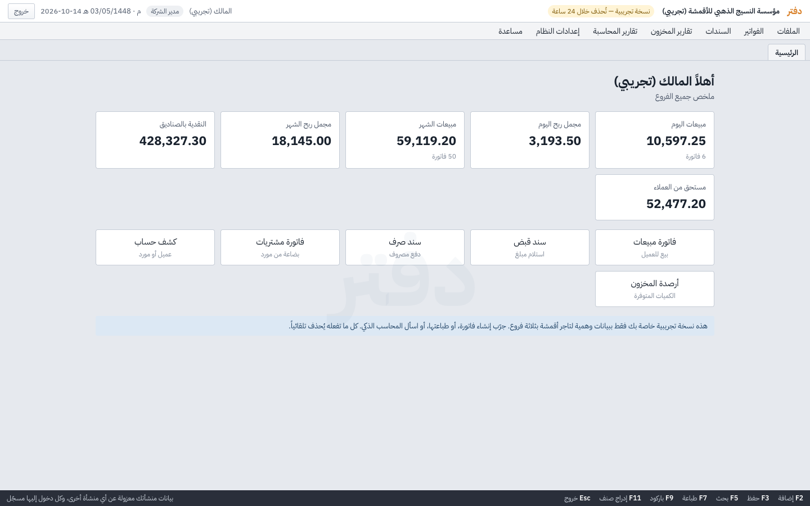

## 2) تأسيس الدليل من قالب

**الملفات ← تأسيس الدليل من قالب**

لا يُقبل أي قيد قبل وجود دليل حسابات. عند أول دخول لشركة جديدة:

1. اختر القالب **دليل تجارة الأقمشة — جملة وتجزئة** (157 حسابًا) واضغط **معاينة الدليل**.
2. راجع الحسابات، وحدد **تاريخ بدء استخدام الحسابات**، ثم اضغط **تطبيق القالب**.
   في القوالب التي فيها حسابات متغيرة العرض يُطلب منك تأكيد سياسة العرض أولًا.
3. أو اضغط **سأنشئ الدليل يدويًا بدل القالب** إذا أردت بناءه بنفسك.

القالب يُطبَّق مرة واحدة فقط. لا يُدمج مع دليل قائم ولا يستبدله. بعد التطبيق تعرض الشاشة القالب الذي أُسس منه الدليل.

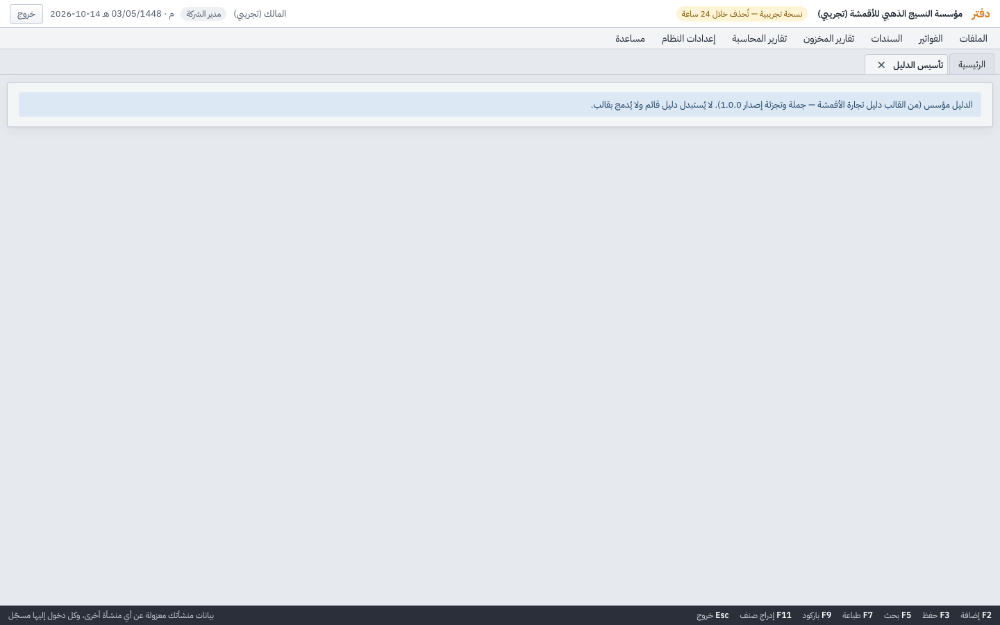

## 3) دليل الحسابات

**الملفات ← دليل الحسابات**

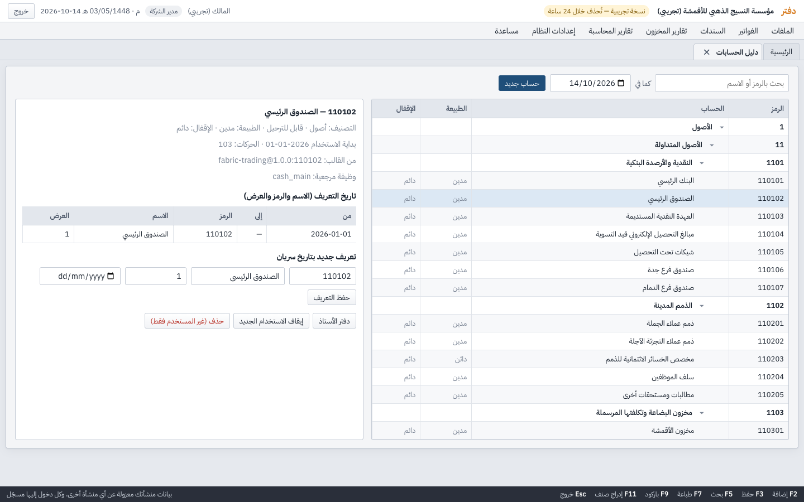

- الشجرة على اليمين. اضغط أي حساب لتظهر **بطاقته** على اليسار، وفيها:
  - التصنيف وطبيعة الحساب (مدين / دائن).
  - الإقفال (دائم أو مؤقت يُقفل آخر السنة).
  - بداية الاستخدام وعدد الحركات.
  - القالب الذي جاء منه، والوظيفة المرجعية.
- **كما في**: اختر تاريخًا لترى الأسماء والرموز كما كانت في ذلك اليوم.
- **تعريف جديد بتاريخ سريان**: لتغيير اسم الحساب أو رمزه أو طريقة عرضه ابتداءً من تاريخ معيّن. اكتب الرمز والاسم والتاريخ، ثم **حفظ التعريف**.
  القيود والتقارير القديمة تحتفظ بالاسم القديم، ولا يُعاد استخدام رمز سبق استعماله أبدًا.
- **حساب جديد**: ابدأ من الحساب الأب، واكتب الرمز (حتى 50 خانة) والاسم (حتى 200 حرف).
- **إيقاف الاستخدام الجديد**: يمنع القيود الجديدة بعد تاريخ معيّن، ويحتفظ بالرصيد والتاريخ.
- **حذف (غير المستخدم فقط)**: الحساب الذي عليه حركة لا يُحذف. استخدم الإيقاف بدلًا من الحذف.
- **دفتر الأستاذ**: يفتح حركة الحساب مباشرة.

## 4) السنوات والفترات

**إعدادات النظام ← السنوات والفترات**

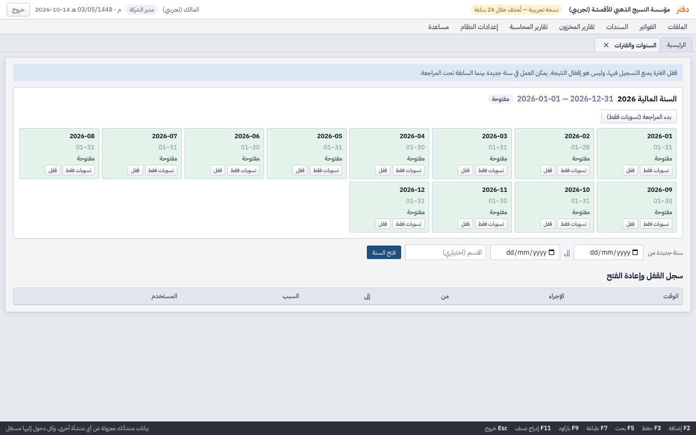

- كل سنة مقسّمة إلى أشهر. لكل شهر واحدة من ثلاث حالات:
  - **مفتوحة**: الجميع يسجّل.
  - **تسويات المدير فقط**: المدير وحده يسجّل.
  - **مقفلة**: لا تسجيل.
- **قفل** أو **تسويات فقط** تحت الشهر: يطلب تأكيد الهوية.
- **فتح** للشهر المقفل: يطلب **سببًا** وتأكيد الهوية.
- **بدء المراجعة (تسويات فقط)**: تنقل السنة إلى «تحت المراجعة» استعدادًا لقيود التسوية.
- **سنة جديدة من / إلى** ثم **فتح السنة**:
  - لا يجوز أن تتداخل السنوات.
  - إذا تركت فجوة بين سنتين يُطلب منك سببها.
  - يمكنك العمل في السنة الجديدة والسابقة ما زالت تحت المراجعة.
- **سجل القفل وإعادة الفتح** أسفل الشاشة: من فعل ماذا، ومتى، ولماذا.
- إذا أُعيد فتح سنة سابقة تظهر على السنوات اللاحقة علامة **تحتاج مراجعة لتغير سنة سابقة**.

> قفل الشهر **ليس** إقفالًا للأرباح. هو يمنع التسجيل فقط. إقفال النتيجة في الشاشة رقم 10.

## 5) سند قيد والمسودات

**السندات ← سند قيد** · **السندات ← المسودات**

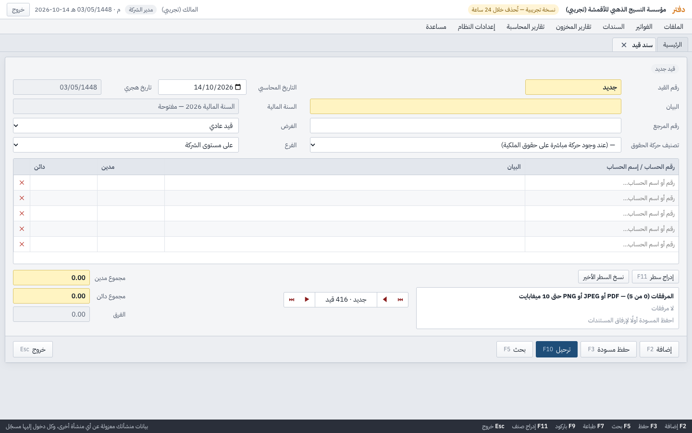

**تسجيل قيد:**

1. اكتب **التاريخ المحاسبي** و**البيان** (إلزامي، حتى 500 حرف). **رقم المرجع** اختياري (حتى 200).
2. **الغرض**:
   - **قيد عادي**: للتسجيل اليومي.
   - **تسوية مراجعة**: يحتاج **دفعة تسويات** مفتوحة (انظر الشاشة رقم 8).
   - **افتتاح التأسيس**: الأرصدة الافتتاحية، ويُستخدم مرة واحدة فقط.
3. **تصنيف حركة الحقوق**: يُطلب إذا لمس القيد حسابات حقوق الملكية مباشرة (مساهمات، توزيعات أو مسحوبات، تحويل احتياطي، تعديل مباشر سابق، حركات أخرى). من دونه تُمنع الموافقة على القوائم.
4. في الأسطر: الحساب، والبيان، والمبلغ في **مدين** أو **دائن** (لا في الاثنين معًا).
   - الأرقام العربية مقبولة.
   - لا يُقبل أكثر من خانتين بعد الفاصلة، ولا تقريب.
5. **F3 حفظ مسودة**: تُحفظ دون أي أثر مالي، حتى لو لم تكن متوازنة.
6. **F10 ترحيل**: يتحقق النظام من كل شيء: التوازن، والفترة مفتوحة، والحساب مسموح في ذلك التاريخ. بعدها يصبح القيد نهائيًا.

**المسودات:**

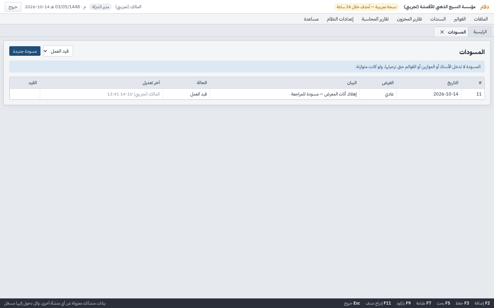

- تعرض كل المسودات حسب الحالة: **قيد العمل** / **مؤجلة** / **ملغاة** / **مرحّلة**.
- إذا عدّل شخصان المسودة نفسها في الوقت نفسه، يرفض النظام الحفظ الثاني بدل أن يمحو تعديل الأول.
- من داخل المسودة: **إلغاء المسودة**، أو **تأجيل بسبب** (مثلًا: تخص السنة القادمة).
- الإقفال النهائي يُمنع ما دامت هناك مسودة «قيد العمل» داخل السنة. رحّلها أو ألغها أو أجّلها.

**المرفقات:** بعد حفظ المسودة اضغط **إرفاق ملف**.

- الأنواع المقبولة: PDF أو JPEG أو PNG، حتى 10 ميغابايت، وحتى 5 مرفقات فعّالة.
- النظام يتحقق من نوع الملف الحقيقي، لا من امتداده.
- لا يُحذف مرفق. يُستبعد مع ذكر السبب، ويبقى في السجل.

## 6) اليومية العامة وتفاصيل القيد

**السندات ← اليومية العامة**

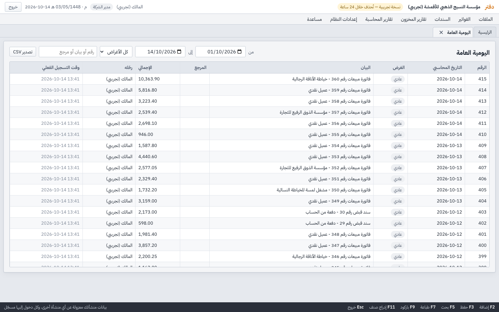

- البحث برقم القيد أو بالنص أو بالمرجع، مع التصفية بالتاريخ وبالغرض. اضغط القيد لفتحه.

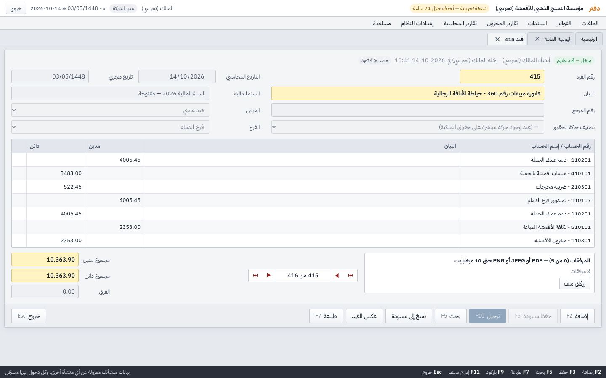

- أعلى القيد يظهر من أنشأه ومن رحّله ومتى، ومصدره (مثلًا: فاتورة).
- القيد المرحّل **لا يُعدّل ولا يُحذف**، وهذه القاعدة محمية في قاعدة البيانات نفسها. للتصحيح:
  - **عكس القيد**: يُنشئ قيدًا معاكسًا مرتبطًا بالأصل، بالتاريخ الذي تختاره. لكل قيد عكس واحد فقط.
  - **نسخ إلى مسودة**: نسخة مستقلة تعدّلها ثم ترحّلها.
- قيود الإقفال النظامي لا تُعكس ولا تُنسخ.

## 7) دفتر الأستاذ وميزان المراجعة

**تقارير المحاسبة ← دفتر الأستاذ العام** · **تقارير المحاسبة ← ميزان مراجعة** · **تقارير المحاسبة ← كشف حساب** (للعملاء والموردين)

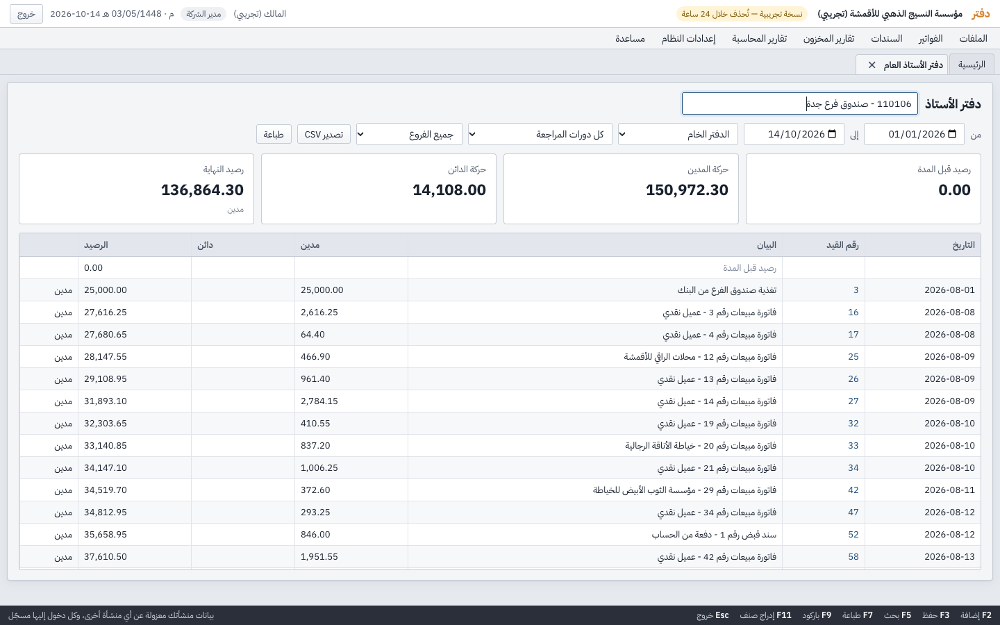

- اكتب رقم الحساب أو اسمه واضغط Enter. يظهر:
  - الرصيد قبل المدة.
  - حركة المدين والدائن.
  - كل حركة مع رصيدها المتراكم.
- اضغط رقم القيد لفتحه.

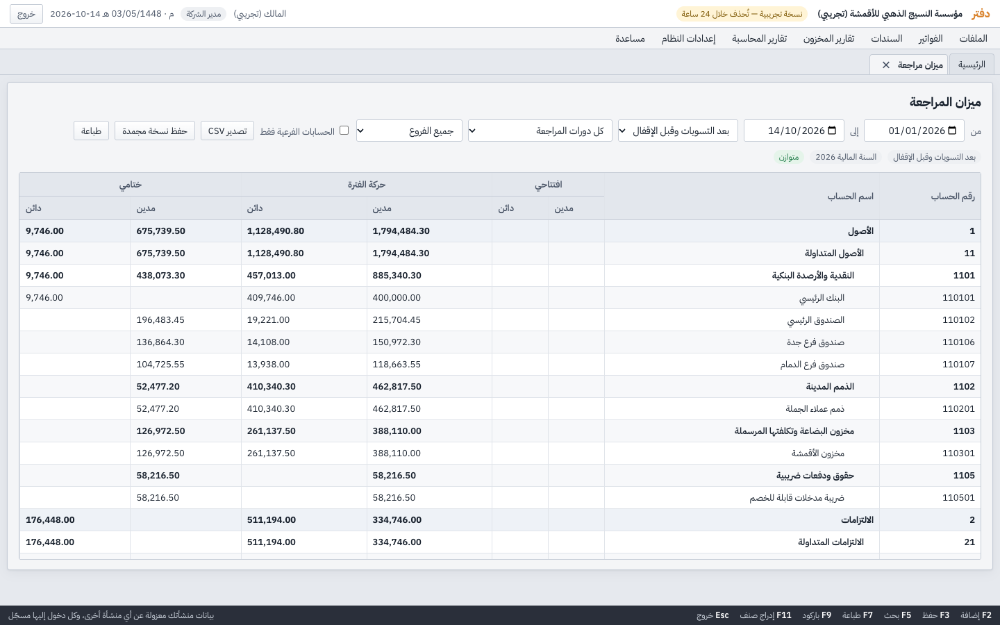

**وضع العرض** (في الأستاذ والميزان والقوائم):

| الوضع | ماذا يعرض |
|---|---|
| **الدفتر الخام** | كل القيود المرحّلة كما هي |
| **قبل التسويات** | دون قيود التسوية ودون الإقفال |
| **التسويات فقط** | قيود التسوية وحدها |
| **بعد التسويات وقبل الإقفال** | الأرصدة النهائية قبل نقل الأرباح |
| **بعد الإقفال** | بعد نقل النتيجة إلى الأرباح المبقاة. يظهر تنبيه إذا لم تكن السنة نهائية |

- **دورة المراجعة** و**الفرع**: لحصر العرض.
- علامة **متوازن** تؤكد أن المدين يساوي الدائن.
- **تصدير CSV**: للفتح في Excel. الملف محمي من الصيغ الضارة.

## 8) دورات المراجعة وورقة التسويات

**إعدادات النظام ← دورات المراجعة** · **تقارير المحاسبة ← ورقة التسويات**

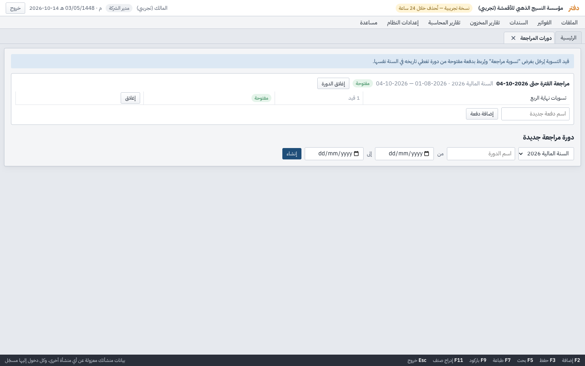

1. **دورة مراجعة جديدة**: اختر السنة، واكتب اسم الدورة وفترتها، ثم **إنشاء**.
2. داخل الدورة اكتب **اسم دفعة جديدة** (مثل: تسويات نهاية الربع) ثم **إضافة دفعة**.
3. سجّل قيود التسوية من **سند قيد** بغرض **تسوية مراجعة**، واختر الدفعة.
4. بعد الانتهاء: **إغلاق** للدفعة، ثم **إغلاق الدورة**.

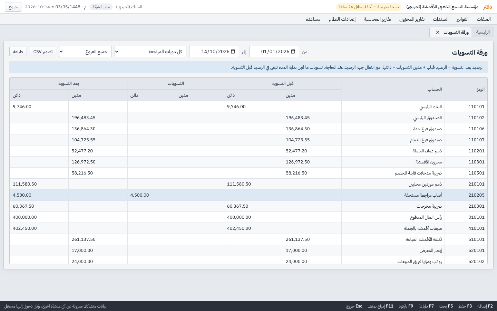

ورقة التسويات تعرض لكل حساب ثلاثة أعمدة: **قبل التسوية**، و**التسويات**، و**بعد التسوية**.
الحسابات التي تأثرت بالتسوية مظللة.

## 9) القوائم المالية والنسخ المحفوظة

**تقارير المحاسبة ←**

- **حساب المتاجرة والأرباح والخسائر (قائمة الدخل)**
- **الميزانية العمومية (المركز المالي)**
- **قائمة التغيرات في حقوق الملكية**

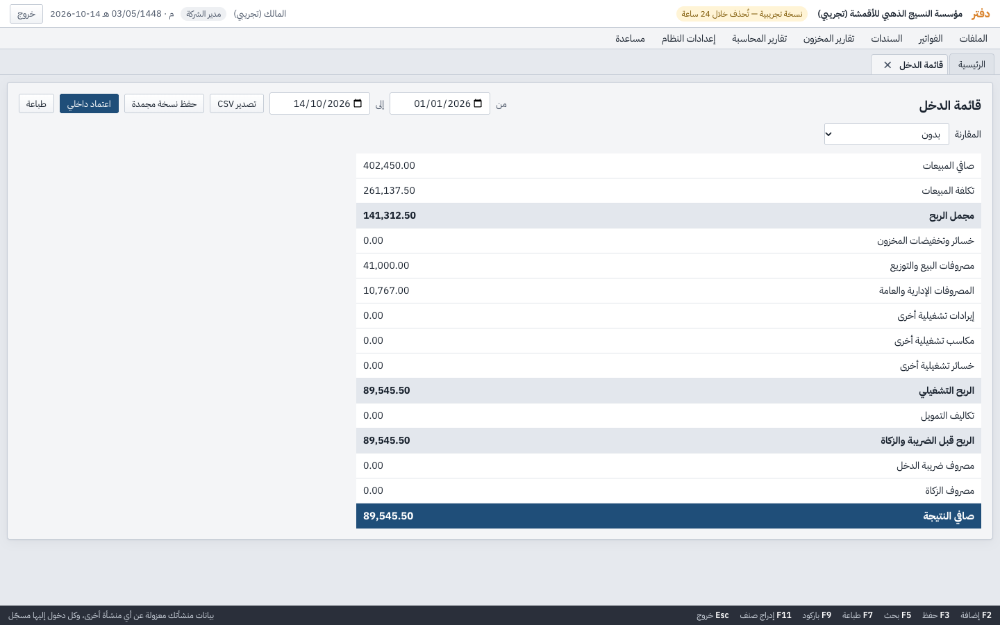

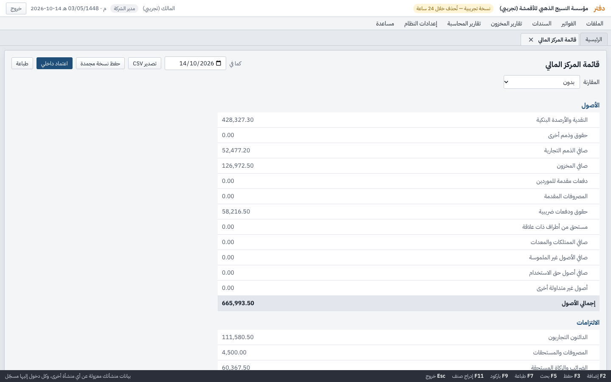

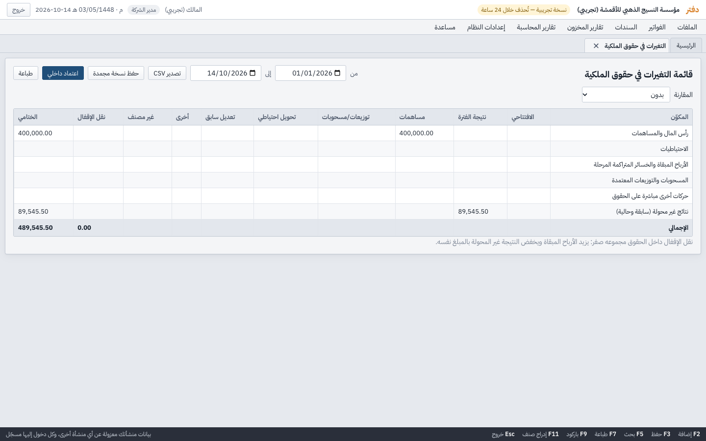

- اضغط أي سطر في القائمة لترى الحسابات التي تكوّنه، ثم اضغط الحساب لفتح دفتر الأستاذ.
- **المقارنة**:
  - **مقارنة تاريخية حية**: الفترة السابقة من الدفاتر الحالية.
  - **كما صدرت (نسخة محفوظة)**: الأرقام والأسماء كما حُفظت وقتها.
  - **إعادة عرض بتعريفات حديثة**: الأرقام القديمة بأسماء الحسابات الحالية.
- إذا كان هناك حساب بلا قاعدة عرض، أو حركة حقوق بلا تصنيف، تظهر المشكلة بوضوح ويُمنع الاعتماد. النظام لا يضع رقمًا موازنًا من عنده.
- **حفظ نسخة مجمدة**: تحفظ القائمة كما هي الآن مع غرضها (مثلًا: للبنك).
- **اعتماد داخلي**: نسخة معتمدة. يحتاج قائمة بلا مشكلات، وسنوات سابقة نهائية، وتأكيد الهوية.
  الاعتماد داخلي فقط، ولا يعني اعتماد مراجع خارجي.

**تقارير المحاسبة ← النسخ المحفوظة والمعتمدة**

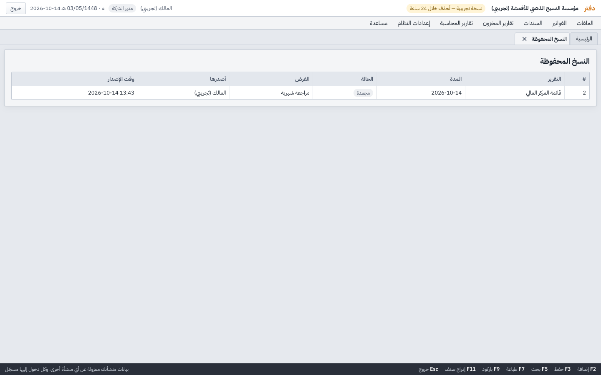

- اضغط أي نسخة لترى:
  - **سلامة المحتوى مطابقة**: لم يتغير فيها شيء منذ حفظها.
  - تنبيه إذا تغيّرت الدفاتر بعد الحفظ (النسخة صحيحة كما صدرت، لكنها قد لا تمثل الوضع الحالي).

## 10) إقفال السنة المالية

**إعدادات النظام ← إقفال السنة المالية**

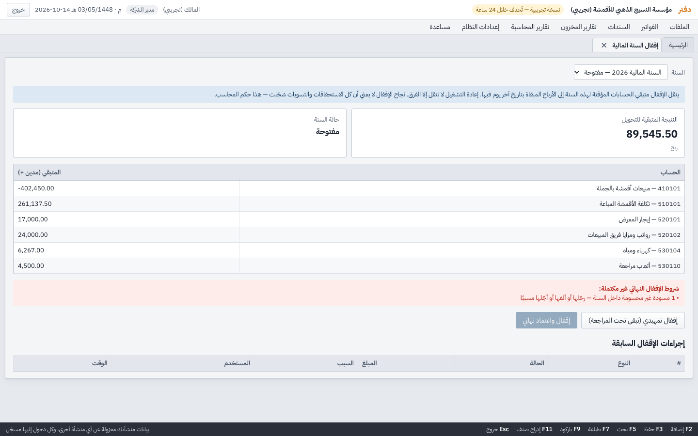

1. اختر **السنة**. تعرض الشاشة **النتيجة المتبقية للتحويل** (ربح أو خسارة)، والحسابات المؤقتة التي ستُصفّر.
2. **شروط الإقفال النهائي غير مكتملة** تظهر بالأحمر إن وُجدت، مثل مسودة غير محسومة أو حركة حقوق بلا تصنيف.
3. اختر طريقة الإقفال:
   - **إقفال تمهيدي (تبقى تحت المراجعة)**: ينقل النتيجة ويُبقي السنة مفتوحة للتسويات.
   - **إقفال واعتماد نهائي**: ينقل النتيجة، ويجعل السنة **معتمدة نهائيًا**، ويقفل كل أشهرها، ويحفظ خمس نسخ مجمدة: ميزان المراجعة قبل الإقفال وبعده، والقوائم الثلاث.
4. اكتب السبب وأكّد كلمة المرور.

- قيد الإقفال مؤرخ بآخر يوم في السنة، ويذهب إلى حساب الأرباح المبقاة المحدد للشركة.
- إذا سُجلت تسوية بعد الإقفال، فإعادة الإقفال (**إقفال تكميلي**) تنقل **الفرق فقط**، ولا تكرر ما نُقل سابقًا.
- السنة الجديدة لا تحتاج قيدًا افتتاحيًا. الأرصدة الدائمة تنتقل تلقائيًا.
- **إجراءات الإقفال السابقة** أسفل الشاشة: كل عملية إقفال، ومبلغها، وسببها، ومن نفّذها.

## 11) المستخدمون والدعوات

**إعدادات النظام ← المستخدمون والدعوات** (لمدير الشركة)

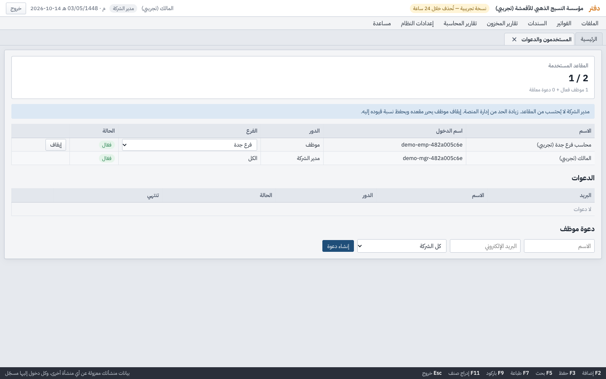

- **المقاعد المستخدمة**: عدد الموظفين الفعّالين والدعوات المعلّقة. مدير الشركة لا يُحسب من المقاعد.
  زيادة عدد المقاعد تكون من إدارة المنصة.
- **دعوة موظف**: الاسم، والبريد، والفرع (أو **كل الشركة**)، ثم **إنشاء دعوة**.
  يظهر رابط الدعوة **مرة واحدة**. أرسله للموظف بنفسك. صلاحيته 24 ساعة.
- **إلغاء** لدعوة لم تُستخدم، و**إيقاف** أو **إعادة تفعيل** لموظف. الإيقاف يحرر مقعده فورًا ويحفظ تاريخه.
- الموظف المحدد بفرع يرى فرعه فقط.

## 12) سجل الدخول والإجراءات

**إعدادات النظام ← سجل الدخول والإجراءات**

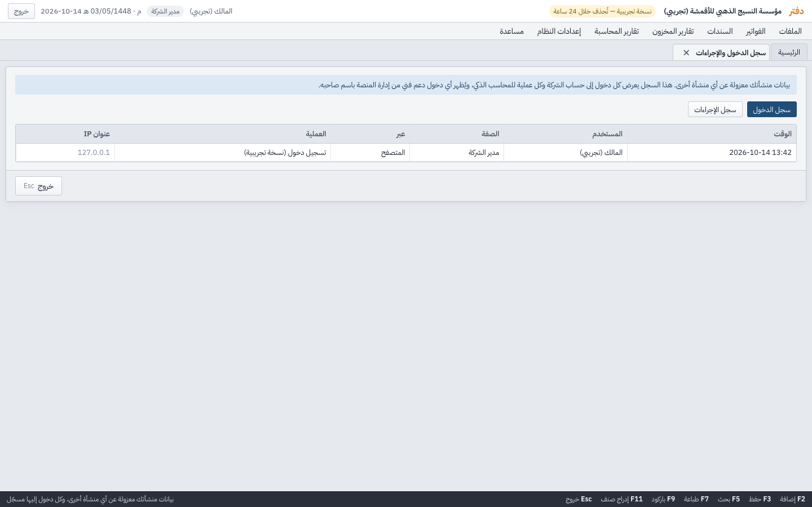

- **سجل الدخول**: كل دخول إلى حساب الشركة وكل عملية للمحاسب الذكي، مع الوقت والمستخدم والصفة وعنوان IP.
- **سجل الإجراءات**: كل تعديل مهم، مع من نفّذه، والسبب، والقيمة قبله وبعده.
- إذا دخل **الدعم الفني** من إدارة المنصة يظهر في هذا السجل باسمه، مع عبارة «الدعم الفني — إدارة المنصة».

## 13) لوحة إدارة المنصة (للمشرف العام فقط)

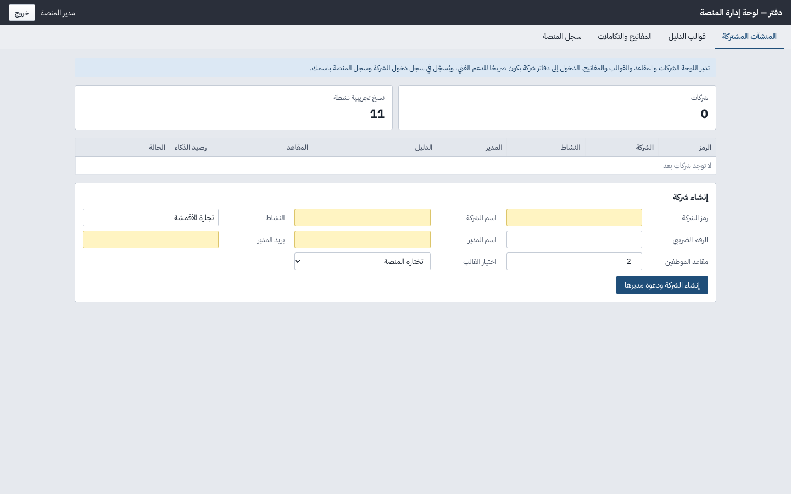

- **المنشآت المشتركة**: إنشاء شركة (الرمز، والاسم، والنشاط، وعدد المقاعد، واسم المدير وبريده).
  يظهر **رابط دعوة المدير** مرة واحدة. أرسله له بنفسك، وصلاحيته 24 ساعة. من هنا أيضًا تُعدّل المقاعد ويُشحن رصيد المحاسب الذكي.
- **دخول دعم فني**: يفتح دفاتر الشركة لحل مشكلة، بعد كتابة السبب (مثل رقم البلاغ).
  يُنسب كل إجراء إليك، ويظهر في سجل الشركة وسجل المنصة.
- **قوالب الدليل**: نشر القوالب. القالب المنشور لا يُعدّل، وأي تغيير يكون في إصدار جديد.
- **المفاتيح والتكاملات**: مفاتيح الذكاء الاصطناعي والتكاملات، ولا يراها غير المشرف.
- **سجل المنصة**: ما فعله المشرف.
